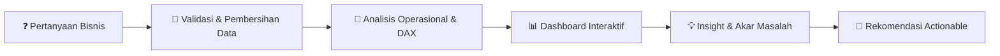

 

<!-- Tambahkan baris berikut HANYA jika Anda memang menguasainya:

-->

## 👋 Tentang Saya

Saya lulusan **S1 Sains Data** yang berfokus pada **Digital Business Intelligence**. Saya bekerja dengan satu prinsip: **angka baru berguna kalau bisa mengubah keputusan**.

Karena itu, setiap analisis saya tidak berhenti di grafik. Menggabungkan Power BI, Python, dan sertifikasi Excel Expert, saya mencari pertanyaan bisnisnya, membedah variansi operasional & bottleneck, serta memvalidasi ketat angka agar metrik di dashboard tidak menyesatkan, lalu menutupnya dengan rekomendasi yang bisa ditindaklanjuti.   

- 🎓 **Pendidikan:** Universitas Koperasi Indonesia — Sains Data
- 📍  **Lokasi:** Indonesia
- 🔎 **Mencari:** posisi *Data Analyst* / *Business Intelligence Analyst* (magang atau penuh waktu)

## 🛠️ Keahlian

| Bidang | Kemampuan |
|---|---|
| 📊 **Visualisasi & BI** | Power BI Desktop, SAP Analytics Cloud, Desain Dashboard Interaktif, KPI, Slicer |
| 🧮 **Pemodelan & Statistik** | Python, DAX (Measure, Margin, YoY), Regresi Linear Berganda, Uji McNemar |
| 📑 **Pengolahan Data** | Microsoft Excel (Certified Expert), Pembersihan Data, Pemeriksaan Kualitas & Validasi Metrik |
| 💡 **Analisis Bisnis & Operasional** | SI&OP / Operation Planning, Evaluasi Variansi Operasional (*Favorable/Unfavorable*), Identifikasi *Bottleneck*, Efisiensi Waktu Produksi |
| 🤖 **Tools & Generative AI** | Pemanfaatan Gen AI untuk Analisis & Dokumentasi, Mendeley |
| 🗣️ **Komunikasi & Kepemimpinan** | Menyusun *Insight* & Rekomendasi *Actionable*, Mentoring Praktikum, Keprotokolan Acara |
<!-- Tambahkan baris berikut HANYA jika Anda memang menguasainya:
| 🐍 **Bahasa Pemrograman** | Python (pandas, matplotlib), SQL |
-->

## 🔄 Cara Saya Bekerja

<!-- Tambahkan baris berikut HANYA jika Anda memang menguasainya:
## 🚀 Project Unggulan

### 1️⃣ US Furniture Sales Performance
<table>
<tr>
<td width="46%"></td>
<td>

**Masalah:** Penjualan kategori Furniture di pasar AS besar, tetapi apakah menguntungkan?

**Temuan:**
- Dari penjualan **$742 ribu**, profit hanya **$18,4 ribu** (margin **2%**).
- **Tables** menjual banyak tetapi merugi **−$17,7 ribu**. **Bookcases** juga merugi.
- Profit berbalik negatif saat **diskon mencapai 30% ke atas**.

**Rekomendasi:** batasi diskon, tinjau harga Tables, dan andalkan Chairs serta Furnishings.

🧰 `Power BI` `DAX` `Global Superstore` · 👥 Proyek tim (Team 4 Merauke, RevoU)

[➡️ Lihat repo](https://github.com/ashafamultazam/Data-Analytics-and-Gen-AI-Project)

</td>
</tr>
</table>

### 2️⃣ Global Sales and Profitability Dashboard
<table>
<tr>
<td width="46%"></td>
<td>

**Masalah:** Seberapa besar diskon menggerus keuntungan, dan segmen mana yang paling menguntungkan?

**Temuan:**
- Total penjualan **118,73 juta** dengan margin **14,23%**.
- Margin turun dari **21,86% (tanpa diskon)** menjadi **9,07% (diskon tinggi)**.
- Segmen **Enterprise merugi**, sementara **Government** paling dominan.

**Rekomendasi:** evaluasi kebijakan diskon tinggi dan telusuri penyebab kerugian Enterprise.

🧰 `Power BI` `DAX` `Excel` `Analisis Profitabilitas`

[➡️ Lihat repo](https://github.com/ashafamultazam/Tugas-Business-Intelligence)

</td>
</tr>
</table>

### 3️⃣ Dairy Strategic Performance Dashboard
<table>
<tr>
<td width="46%"></td>
<td>

**Masalah:** Bagaimana tren pendapatan industri susu di India dan di mana risikonya?

**Temuan:**
- Revenue **58,73 juta INR**, turun sekitar **7,5%** dari 2019 ke 2022.
- **4 merek** menguasai hampir **79%** revenue. **Chandigarh dan Delhi** menyumbang ±25%.
- Menemukan bahwa kartu *Total Profit* (−59,59 juta) **menyesatkan** karena membandingkan revenue barang terjual dengan nilai seluruh barang produksi, lalu mengusulkan metrik pengganti (*Sell-Through Rate*).

**Rekomendasi:** kurangi ketergantungan pada merek dan wilayah tertentu, serta perbaiki efisiensi stok.

🧰 `Power BI` `DAX` `Kaggle` `Validasi Data`

[➡️ Lihat repo](https://github.com/ashafamultazam/Dairy-Performance-Dashboard)

</td>
</tr>
</table>
-->

## 🧠 Yang Membedakan Saya

- ✅ **Berorientasi Keputusan.** Setiap analisis tidak berhenti di grafik, melainkan dilengkapi akar penyebab (*bottleneck*), temuan variansi operasional, dan rekomendasi *actionable*.
- ✅ **Integritas & Validasi Data.** Memeriksa kualitas data secara ketat dan menandai metrik yang berpotensi menyesatkan pada *dashboard* sebelum dipresentasikan.
- ✅ **Transparan & Objektif.** Selalu terbuka mengenai batasan analisis serta metodologi yang digunakan untuk menjaga keakuratan interpretasi bisnis.
- ✅ **Dokumentasi Terstruktur.** Repositori disusun rapi dengan README komprehensif, visualisasi pratinjau, dan petunjuk eksekusi kode yang jelas.
- ✅ **Adaptif & Berbasis AI.** Memanfaatkan Generative AI untuk mengakselerasi pemodelan dan efisiensi kerja tanpa mengabaikan verifikasi manual.

## 📫 Let's Connect!

*Terbuka untuk diskusi, kolaborasi, dan peluang karier di bidang data.*

 

